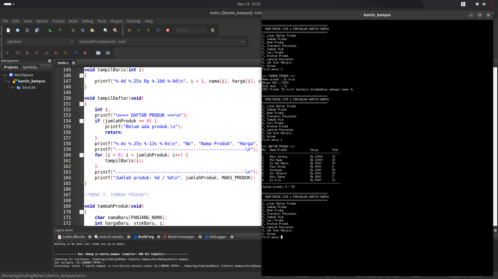
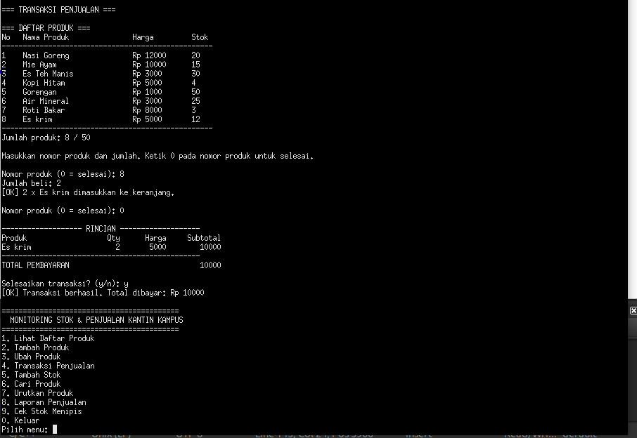
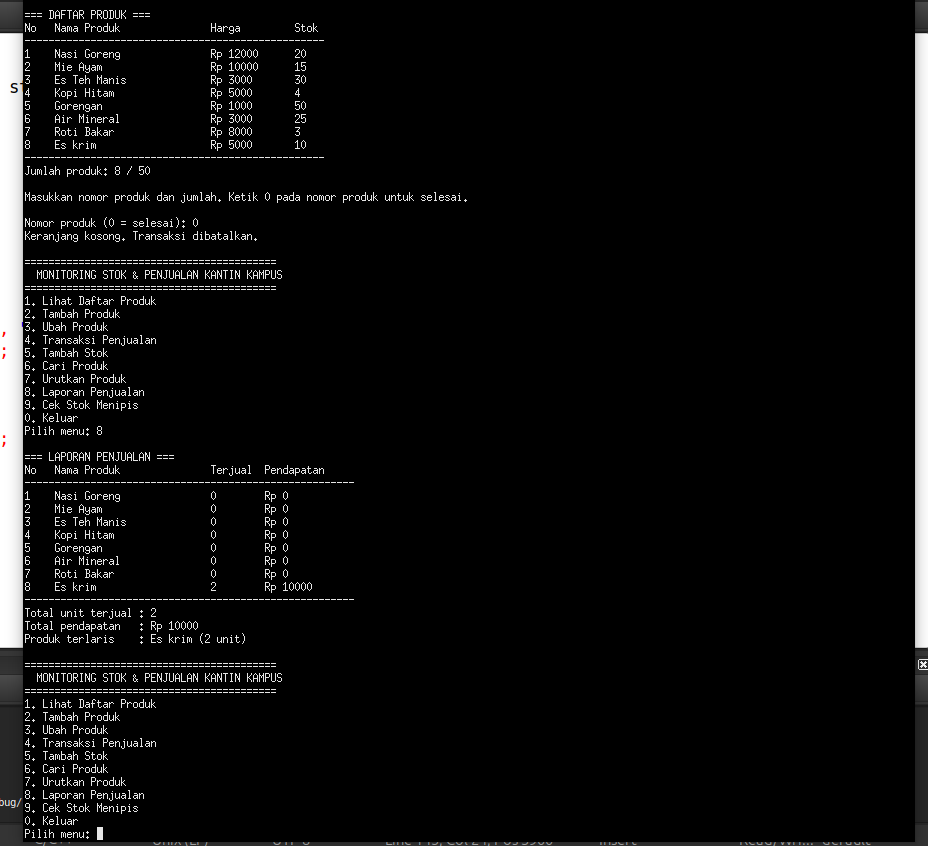
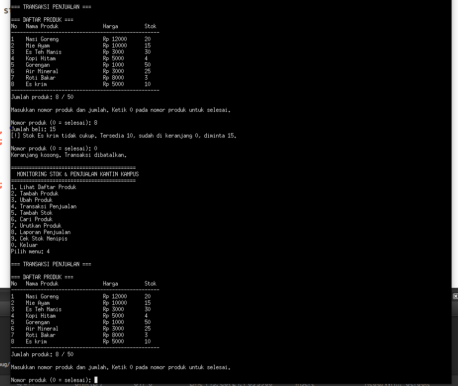
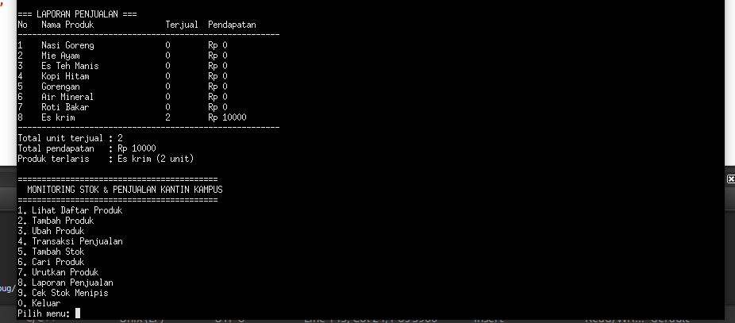
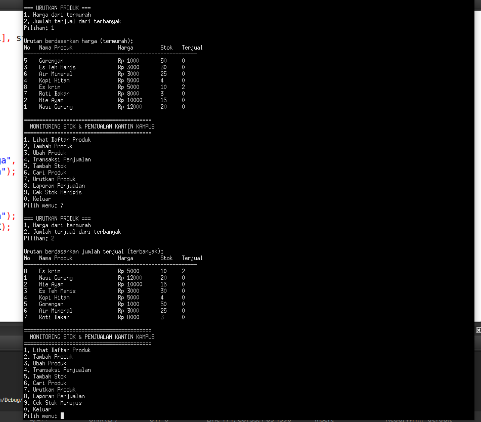
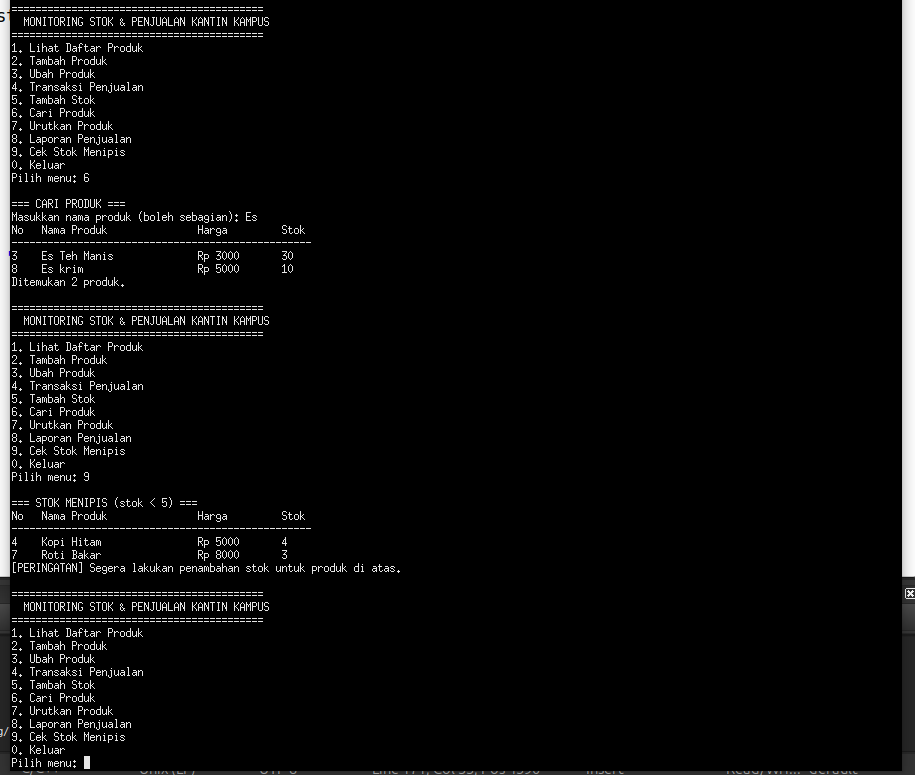

# Proyek-Array-C-C2583207001
### Nama   : Muhammad Ghazi Algifari
### Nim    : C2583207001
### Kelas  : PTI3B
### Mata Kuliah : Algoritma dan Pemrograman Lanjut

# Nama Proyek : Kantin Kampus
# Deskripsi
sebuah aplikasi bahasa C untuk membantu pengelola kantin kampus memantau stok, memproses transaksi penjualan, dan melihat laporan penjualan. Aplikasi menggantikan pencatatan manual
# Daftar Fitur
### 1 Lihat Daftar Produk
### 2 Tambah Produk
### 3 Ubah Produk
### 4 Transaksi Penjualan
### 5 Tambah Stok
### 6 Cari Produk
### 7 Urutkan Produk
### 8 Laporan Penjualan
### 9 Cek Stok Menipis
### 10 Keluar

# Array
char nama[MAKS_PRODUK][PANJANG_NAMA];  // array karakter 2 dimensi: nama produk
int  harga[MAKS_PRODUK];               // array 1 dimensi: harga satuan
int  stok[MAKS_PRODUK];                // array 1 dimensi: stok tersedia
int  terjual[MAKS_PRODUK];             // array 1 dimensi: jumlah unit terjual
long pendapatan[MAKS_PRODUK];          // array 1 dimensi: pendapatan per produk
int  jumlahProduk = 0;                 // jumlah data aktif

# Petunjuk Kompilasi dan Menjalankan Program
### 1 Kompilasi Program
Buka file main.c menggunakan aplikasi Code::Blocks. Setelah itu, klik menu Build pada bagian toolbar, kemudian pilih Build atau tekan tombol F9. Tunggu hingga proses kompilasi selesai. Jika muncul keterangan 0 errors, berarti program berhasil dikompilasi.

### 2 Menjalankan Program
Setelah proses kompilasi berhasil, klik tombol Run pada toolbar atau tekan Ctrl + F10. Program akan berjalan dan menampilkan menu utama Monitoring Stok dan Penjualan Kantin Kampus. Selanjutnya, program siap digunakan sesuai pilihan menu yang tersedia.

##Tambah Produk

##Transaksi

##Pembaruan Stok

##Stok Tidak Cukup

##Laporan

##Pengurutan

##Pencarian dan Stok

